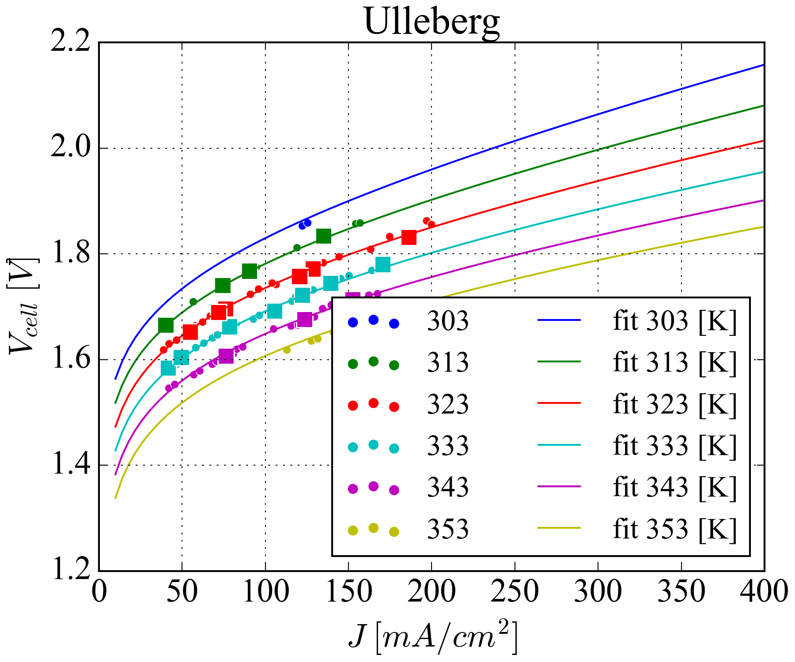
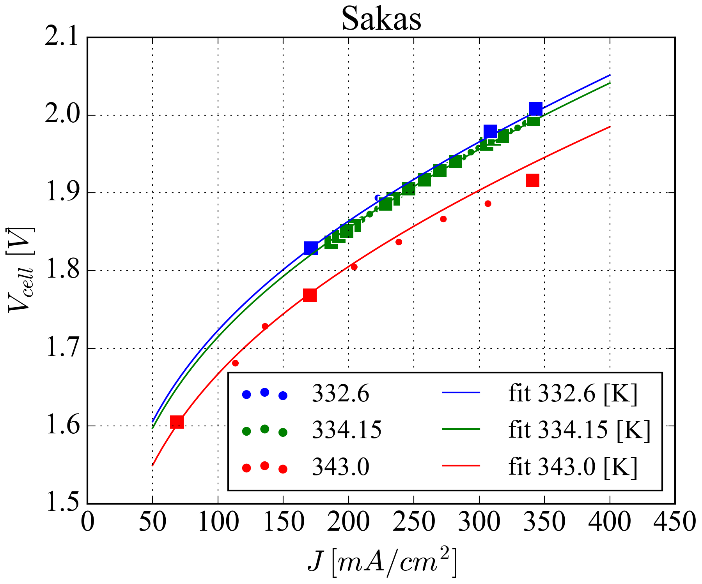
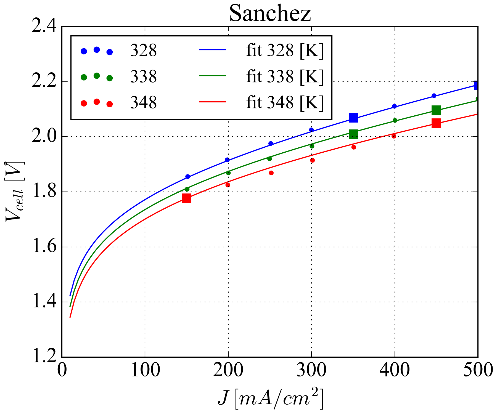
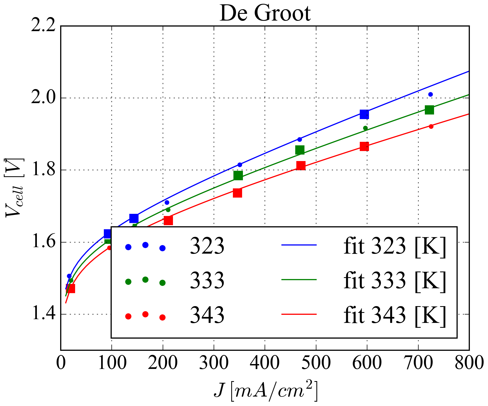

# AEC-Modelling
DTU Alkaline electrolyser modelling built during visitng PhD period (2022) @ DTU energy under supervision of Henrik Lund Frandsen. <br>
<p float="left">
  
 
</p>


## Description of the model 🧰
The objective is to build a model that can describe the polarisation curve, which depends on the setting parameters such as: <br>
- Wt% of the electrolyte, in this specific case we are talking about KOH 
- Temperature
- Operating pressure, which directly influences electrolyte density


## installation
### installation with a general virtual env
`pip install -r requirements.txt`

### installation with conda 
In `conda`-enabled shell (e.g. Anaconda Prompt), run:
 - `conda create -n AEC-Modeling`
 - `conda activate pip install -r requirements.txt`
 - `pip install -r requirements.txt`

## Files description 📂

There are basically 4 types of files in this repository <br>
- Main, is the main operating code 
- func_class, is the classs of the actual AEC model, containing every function built 
- "Fitting Parameters" folder contains dataframe and txt files, are polynomial or Arrenhius coefficients for $i_0$ and $\alpha$, obtained through the fitting of the experimental data from Kibria and Miles experiments
- "Experiments" folder contain.csv files, are data from bachelor thesis ( including both Comsol and experimental data) and the one from Henrik

## Examples 🖼️

<p float="left">
  
 
</p>

<p float="left">
  
  
</p>

## Citation ✅
[1] Lingkang Jin, Rafael Nogueira Nakashima, Gabriele Comodi, Henrik Lund Frandsen, Alkaline electrolysis for green hydrogen production: A novel, simple model for thermo-electrochemical coupled system analysis, Applied Thermal Engineering, Vol. 262, 2025, 125154.
ISSN: 1359-4311. https://doi.org/10.1016/j.applthermaleng.2024.125154

[1] Lingkang Jin, Rafael Nogueira Nakashima, Henrik Lund Frandsen, Gabriele Comodi. Alkaline Electrolysis for Green Hydrogen Production: Techno-Economic Analysis of Temperature Influence and Control. 36th International Conference on Efficiency, Cost, Optimization, Simulation and Environmental Impact of Energy Systems (ECOS 2023), 908–919. https://doi.org/10.52202/069564-0082
```
@article{JIN2025125154,
title = {Alkaline electrolysis for green hydrogen production: A novel, simple model for thermo-electrochemical coupled system analysis},
journal = {Applied Thermal Engineering},
volume = {262},
pages = {125154},
year = {2025},
issn = {1359-4311},
doi = {https://doi.org/10.1016/j.applthermaleng.2024.125154},
url = {https://www.sciencedirect.com/science/article/pii/S1359431124028229},
author = {Lingkang Jin and Rafael {Nogueira Nakashima} and Gabriele Comodi and Henrik Lund Frandsen},
keywords = {Power-to-hydrogen, Alkaline electrolysis, Temperature control, Levelized cost of hydrogen, Hydrogen production},
abstract = {Alkaline water electrolysis (AWE) is the most mature electrochemical technology for hydrogen production from renewable electricity. Thus, its mathematical modeling is an important tool to provide new perspectives for the design and optimization of energy storage and decarbonization systems. However, current models rely on numerous empirical parameters and neglect variations of temperature and concentration alongside the electrolysis cell, which can impact the application and reliability of the simulation results. Thus, this study proposes a simple four-parameter semi-empirical model for AWE system analysis, which relies on minimal fitting data, while providing reliable extrapolation results. In addition, the effect of model dimensionality (i.e., 0D, 1/2D and 1D) are carefully assessed in the optimization of an AWE system. The results indicate that the proposed model can accurately reproduce literature data from four previous works (R2≥0.98), as well as new experimental data. In the system optimization, the trade-offs existing in the lye cooling sizing highlight that maintaining a low temperature difference in AWE stacks (76–80 °C) leads to higher efficiencies and lower hydrogen costs.}
}

@article{Jin2023AlkalineControl,
    title = {{Alkaline Electrolysis for Green Hydrogen Production: Techno-Economic Analysis of Temperature Influence and Control}},
    year = {2023},
    journal = {36th International Conference on Efficiency, Cost, Optimization, Simulation and Environmental Impact of Energy Systems (ECOS 2023)},
    author = {Jin, Lingkang and Nogueira Nakashima, Rafael and Lund Frandsen, Henrik and Comodi, Gabriele},
    pages = {908--919},
    publisher = {ECOS 2023},
    url = {https://www.proceedings.com/069564-0082.html},
    address = {Las Palmas De Gran Canaria, Spain},
    isbn = {978-1-7138-7492-8},
    doi = {10.52202/069564-0082},
    keywords = {Conference Proceedings, Content Hosting, DOI, Digital Library, Print-on-Demand, Proceedings}
}
```

## Code contributers ✒️
- Lingkang Jin (lingkang32@gmail.com/l.jin@tue.nl) <br>
- Rafael Nogueira Nakashima (rafnn@dtu.dk)

## Datasets and numerical models

### Datasets from literature 
1. Ulleberg Ø. Modeling of advanced alkaline electrolyzers: a system simulation approach. Int J Hydrogen Energy 2003;28:21–33. https://doi.org/10.1016/S0360-3199(02)00033-2
2. Sakas G, Ibáñez-Rioja A, Ruuskanen V, Kosonen A, Ahola J, Bergmann O. Dynamic energy and mass balance model for an industrial alkaline water electrolyzer plant process. Int J Hydrogen Energy 2022;47:4328–45. https://doi.org/10.1016/J.IJHYDENE.2021.11.126
3. Sánchez M, Amores E, Rodríguez L, Clemente-Jul C. Semi-empirical model and experimental validation for the performance evaluation of a 15 kW alkaline water electrolyzer. Int J Hydrogen Energy 2018;43:20332–45. https://doi.org/10.1016/j.ijhydene.2018.09.029
4. de Groot MT, Kraakman J, Garcia Barros RL. Optimal operating parameters for advanced alkaline water electrolysis. Int J Hydrogen Energy 2022. https://doi.org/10.1016/j.ijhydene.2022.08.075


### Reversible voltage
[1] 	Domain E, Conductivity SE. A Comprehensive Survey of Alkaline Electrolyzer Modeling : Electrical Domain and Specific Electrolyte Conductivity 2022.<br>
[2]	Kibria MF, MRIDHA MS. Electrochemical studies of the Nickel electrod for the oxygen evolution reaction. Science (80- ) 1996;21.

### Anodic overpotential experiments
[2]	Kibria MF, MRIDHA MS. Electrochemical studies of the Nickel electrod for the oxygen evolution reaction. Science (80- ) 1996;21. <br>
[3]	Miles MH, Kissel G, Lu PWT, Srinivasan S. Effect of Temperature on Electrode Kinetic Parameters for Hydrogen and Oxygen Evolution Reactions on Nickel Electrodes in Alkaline Solutions. J Electrochem Soc 1976;123:332–6. https://doi.org/10.1149/1.2132820.

### Cathodic overpotential experiments
[3]	Miles MH, Kissel G, Lu PWT, Srinivasan S. Effect of Temperature on Electrode Kinetic Parameters for Hydrogen and Oxygen Evolution Reactions on Nickel Electrodes in Alkaline Solutions. J Electrochem Soc 1976;123:332–6. https://doi.org/10.1149/1.2132820. <br>
[4]	Kibria MF, Mridha MS, Khan AH. Electrochemical studies of a nickel electrode for the hydrogen evolution reaction. Int J Hydrogen Energy 1995;20:435–40. https://doi.org/10.1016/0360-3199(94)00073-9. <br>
[5]	Huot J ‐Y. Hydrogen Evolution and Interface Phenomena on a Nickel Cathode in 30 w/o KOH : I . Kinetics Parameters and Electrode Impedance Between 303 and 363 K. J Electrochem Soc 1989;136:1933–9. https://doi.org/10.1149/1.2097088.

### Electolyte overpotential and ionic conductivity 
[6]	Gilliam RJ, Graydon JW, Kirk DW, Thorpe SJ. A review of specific conductivities of potassium hydroxide solutions for various concentrations and temperatures. Int J Hydrogen Energy 2007;32:359–64. https://doi.org/10.1016/j.ijhydene.2006.10.062.

### Mass tranposort through diaphram
[7]	Vermeiren P, Adriansens W, Moreels JP, Leysen R. Evaluation of the zirfon® separator for use in alkaline water electrolysis and Ni-H2 batteries. Int J Hydrogen Energy 1998;23:321–4. https://doi.org/10.1016/s0360-3199(97)00069-4.

### Concentration assessment
- COH <br>
[6]		Gilliam RJ, Graydon JW, Kirk DW, Thorpe SJ. A review of specific conductivities of potassium hydroxide solutions for various concentrations and temperatures. Int J Hydrogen Energy 2007;32:359–64. https://doi.org/10.1016/j.ijhydene.2006.10.062.

- CO2  <br>
[8]		Tromans D. Temperature and pressure dependent solubility of oxygen in water: A thermodynamic analysis. Hydrometallurgy 1998;48:327–42. https://doi.org/10.1016/s0304-386x(98)00007-3.

### Electrolyte density
[6]	Gilliam RJ, Graydon JW, Kirk DW, Thorpe SJ. A review of specific conductivities of potassium hydroxide solutions for various concentrations and temperatures. Int J Hydrogen Energy 2007;32:359–64. https://doi.org/10.1016/j.ijhydene.2006.10.062.

### Hydrogen and oxygen diffusion
[9] 	Tham MK, Walker RD, Gubbins KE. Diffusion of oxygen and hydrogen in aqueous potassium hydroxide solutions. J Phys Chem 1970;74:1747–51. https://doi.org/10.1021/j100703a015.

### Bubbles evaluation
[10]	Vogt H, Balzer RJ. The bubble coverage of gas-evolving electrodes in stagnant electrolytes. Electrochim Acta 2005;50:2073–9. https://doi.org/10.1016/j.electacta.2004.09.025. <br>
[11]	Hammoudi M, Henao C, Agbossou K, Dubé Y, Doumbia ML. New multi-physics approach for modelling and design of alkaline electrolyzers. Int J Hydrogen Energy 2012;37:13895–913. https://doi.org/10.1016/j.ijhydene.2012.07.015. <br>
[12]	Mandin P, Derhoumi Z, Roustan H, Rolf W. Bubble over-potential during two-phase alkaline water electrolysis. Electrochim Acta 2014;128:248–58. https://doi.org/10.1016/j.electacta.2013.11.068 <br>
[13]	Henao C, Agbossou K, Hammoudi M, Dubé Y, Cardenas A. Simulation tool based on a physics model and an electrical analogy for an alkaline electrolyser. J Power Sources 2014;250:58–67. https://doi.org/10.1016/j.jpowsour.2013.10.086.

